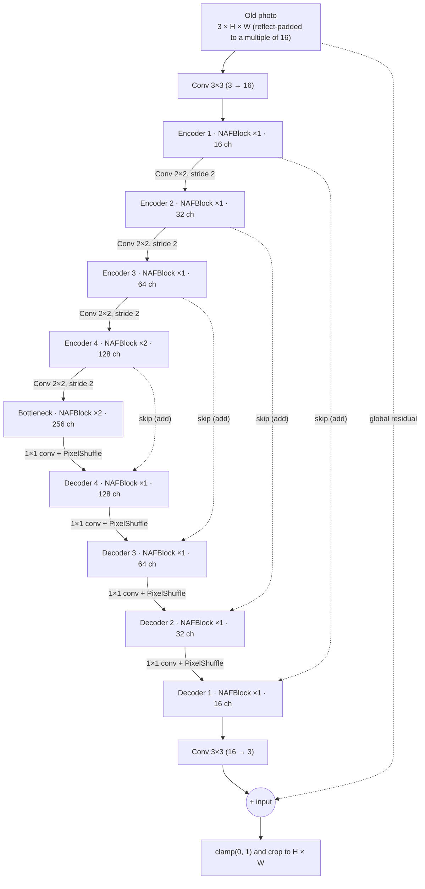

# Old Photo Restoration with NAFNet (Encoder–Decoder)

**English** · [فارسی](#بازسازی-عکس‌های-قدیمی-با-nafnet)

A small, fully self-contained PyTorch notebook that restores degraded "old" photos (blur, noise, faded colors, sepia tint, scratches, blotches, JPEG artifacts) using a compact **NAFNet** encoder–decoder.

No paired dataset of real old photos is needed: we take clean photos, **synthesize the old-photo look on the fly**, and train the network to map *old → clean*.

---

## Table of contents

- [Highlights](#highlights)
- [How it works](#how-it-works)
- [Architecture](#architecture)
- [Inside a NAFBlock](#inside-a-nafblock)
- [Degradation simulator](#degradation-simulator)
- [Data and splits](#data-and-splits)
- [Training](#training)
- [Evaluation and results](#evaluation-and-results)
- [Getting started](#getting-started)
- [Restoring your own photo](#restoring-your-own-photo)
- [Known limitations](#known-limitations)
- [References](#references)

---

## Highlights

- **NAFNet encoder–decoder** with 4 encoder stages, a bottleneck, 4 decoder stages and skip connections. About **1.72M parameters** (`width=16`).
- **Global residual learning:** the network predicts a correction that is added to its input, so it only has to learn *what is wrong* with the photo.
- **Synthetic degradation pipeline** that creates a new "old" version of every crop each time it is sampled (blur, fading, sepia, noise, scratches, blotches, JPEG).
- **~500 real photos** (BSDS500) for training and validation. If you put your own clean photos in `data/`, those are used instead.
- **Honest evaluation:** validation uses whole images that were never used for training, and the final tests use images that were held out completely.
- **EMA weights** for the final model and **8-way test-time augmentation** (4 rotations × flip) at inference.
- **Crowded-scene stress test:** 14 images with many people or objects (10 from BSDS500 held out from training, 4 external images).
- Runs on CPU; a GPU makes it much faster.

## How it works

```
clean photo ──► random 64×64 crop ──► flips / rotations ──► degrade() ──► old crop ─┐
                                                                    │               ▼
                                                                    └─ clean crop ─► NAFNet ─► L1 loss
```

1. Sample a random crop from a clean photo and apply light augmentation.
2. Degrade it with a randomized "old photo" simulator.
3. Feed the degraded crop to NAFNet and compare the output with the clean crop using **L1 loss**.
4. At test time, degrade a full held-out image, restore it, and report **PSNR** and **SSIM** against the original.

## Architecture

NAFNet (Chen et al., 2022) is built from "nonlinear activation free" blocks. The network used here is a U-shaped encoder–decoder:



| Stage | Resolution | Channels | NAFBlocks (encoder) | NAFBlocks (decoder) |
|------:|-----------:|---------:|--------------------:|--------------------:|
| 1 | H × W | 16 | 1 | 1 |
| 2 | H/2 × W/2 | 32 | 1 | 1 |
| 3 | H/4 × W/4 | 64 | 1 | 1 |
| 4 | H/8 × W/8 | 128 | 2 | 1 |
| Bottleneck | H/16 × W/16 | 256 | 2 | – |

Design details:

- **Downsampling** is a strided 2×2 convolution that doubles the channels.
- **Upsampling** is a 1×1 convolution followed by `PixelShuffle(2)`, which halves the channels.
- **Skip connections** are added (not concatenated) to the upsampled features.
- **Global residual:** `output = clamp(ending(x) + input, 0, 1)`.
- **Padding:** inputs are reflect-padded to a multiple of 16 and cropped back afterwards, so any image size works.

## Inside a NAFBlock

Every `NAFBlock` has two residual parts. `c` is the number of channels at that stage.

**Part 1: spatial mixing**

```
x → LayerNorm → Conv1×1 (c→2c) → Depthwise Conv3×3 → SimpleGate (2c→c)
  → × ChannelAttention → Conv1×1 (c→c) → × β → + input
```

**Part 2: feed-forward**

```
y → LayerNorm → Conv1×1 (c→2c) → SimpleGate (2c→c) → Conv1×1 (c→c) → × γ → + y
```

What makes it work:

| Component | What it does |
|---|---|
| `LayerNorm2d` | Normalizes each pixel across the channel dimension. |
| `SimpleGate` | Splits channels in two halves `a`, `b` and outputs `a * b`. This replaces ReLU/GELU as the nonlinearity. |
| Simplified Channel Attention | Global average pool, then a 1×1 conv, then multiply the result back onto the features. No ReLU or sigmoid. |
| Depthwise 3×3 conv | The only place spatial neighbors are mixed. Cheap, because each channel is filtered separately. |
| `β`, `γ` | Learnable per-channel scales, **initialized to zero**, so each block starts as an identity mapping and training is stable. |

## Degradation simulator

`degrade(img)` turns a clean `uint8` image into a synthetic old photo. Each effect is applied randomly with random strength:

| Effect | Details |
|---|---|
| Blur | Gaussian, σ ∈ [0.6, 1.8], applied with probability 0.8 |
| Fading | Reduced contrast (×0.65–0.95) and a small brightness lift |
| Sepia / color cast | Blend with a warm-tinted grayscale version, probability 0.7 |
| Noise | Gaussian, σ ∈ [0.01, 0.035] |
| Scratches | 0–3 vertical lines, 1–2 px wide |
| Blotches | 0–2 dark or bright circular spots |
| JPEG artifacts | Re-encode at quality 35–80, probability 0.6 |

## Data and splits

- **Source:** BSDS500 (cloned automatically from GitHub), about 500 images. To use your own clean photos, create a `data/` folder with at least 50 images (`.jpg`, `.jpeg`, `.png`, e.g. DIV2K); it takes priority.
- **Held-out crowded images:** 10 BSDS500 images with many people or objects are removed *before* the train/validation split, so they are never seen in training.
- **Train / validation split:** 441 / 49 whole images (split by image, not by region, to avoid leakage).
- **Extra tests:** two skimage/sklearn images (`rocket`, `flower`) and 4 external crowded images are used only for testing.
- **Training samples:** random 64×64 crops with flips and 90° rotations, degraded on the fly.

## Training

| Setting | Value |
|---|---|
| Loss | L1 |
| Optimizer | AdamW (lr 1e-3, weight decay 1e-4) |
| LR schedule | 100-step warm-up, then cosine decay over the time budget |
| Batch size | 16 (64×64 crops) |
| Gradient clipping | 1.0 |
| EMA | decay 0.999 with warm-up; the best EMA checkpoint is the final model |
| Budget | `TRAIN_SECONDS = 900` (time-based, increase it on a GPU) |

In the included run (CPU, 900 s), training completed **1,366 steps** and the best validation PSNR was **23.98 dB**, against 20.62 dB for the unrestored degraded input.

## Evaluation and results

Metrics are PSNR (dB) and SSIM against the original image; higher is better. "Restored" uses EMA weights with 8-way TTA. Degradations are randomly generated, so results vary with the seed.

**Held-out test images (never seen in training)**

| Image | PSNR old → restored | SSIM old → restored |
|---|---|---|
| rocket | 18.76 → 26.22 | 0.689 → 0.746 |
| flower | 16.23 → 21.32 | 0.595 → 0.675 |
| **mean** | **17.50 → 23.77** | **0.642 → 0.710** |

Test-time augmentation gives a small gain on top of plain inference (mean PSNR 23.74 → 23.77, SSIM 0.707 → 0.710).

**Crowded-scene test (14 images)**

| | PSNR | SSIM |
|---|---|---|
| Degraded input (mean) | 20.64 | 0.650 |
| Restored (mean) | **23.76** | **0.745** |

PSNR improved on 12 of 14 images and SSIM on all 14. The two exceptions in PSNR are `cyclists` and `horse_herd`, where the input was already relatively clean. Per-image numbers are saved to `results_v4/crowded/metrics.csv`.

Generated outputs (inside `results_v4/`): `training_curves.png`, `<name>_compare.png` (old → restored → original), `<name>_restored.png`, `<name>_old.png`, `zoom_compare.png`, and the model weights.

## Getting started

```bash
git clone https://github.com/<your-username>/<your-repo>.git
cd <your-repo>
pip install torch numpy pillow scipy scikit-image scikit-learn matplotlib
jupyter notebook old_photo_restore_nafnet.ipynb
```

Then run all cells. By default the notebook downloads BSDS500 on first run (needs `git` and internet access). The training budget is controlled by `TRAIN_SECONDS` in the training cell.

## Restoring your own photo

In the last cell, set `MY_PHOTO` to the path of your photo. The restored image is saved into the `results/` folder. Keep in mind that the model was trained on a *synthetic* old-photo simulator, so real photographs with other kinds of damage may restore less well.

## Known limitations

- The model sees only synthetic degradations. Real old photos have more complex damage (tears, creases, heavy stains, missing regions) that this simulator does not produce.
- The default training run is short (15 minutes on CPU). Longer training on a GPU, larger `width`, more blocks, or a bigger clean dataset should help.
- The model saves its weights under the filename `restore_unet.pt`, a leftover from an earlier U-Net version, although the network is NAFNet.
- It is not a face or colorization model: it does not restore colors of black-and-white photos or add missing details.

## References

- L. Chen, X. Chu, X. Zhang, J. Sun. *Simple Baselines for Image Restoration* (NAFNet), ECCV 2022.
- P. Arbeláez et al. *Contour Detection and Hierarchical Image Segmentation* (BSDS500), TPAMI 2011.

---

<div dir="rtl" align="right">

# بازسازی عکس‌های قدیمی با NAFNet

[English](#old-photo-restoration-with-nafnet-encoderdecoder) · **فارسی**

یک نوت‌بوک PyTorch کوچک و مستقل که عکس‌های «قدیمی» و آسیب‌دیده (تاری، نویز، رنگ‌پریدگی، رنگ سپیا، خط‌وخش، لکه و آرتیفکت JPEG) را با یک شبکه‌ی **NAFNet** فشرده از نوع انکدر–دیکدر بازسازی می‌کند.

لازم نیست مجموعه‌داده‌ی جفت‌شده از عکس‌های قدیمی واقعی داشته باشید: عکس‌های سالم را برمی‌داریم، **نسخه‌ی قدیمی را به‌صورت لحظه‌ای شبیه‌سازی می‌کنیم** و شبکه یاد می‌گیرد از عکس قدیمی، عکس تمیز را بسازد.

## فهرست

- [ویژگی‌ها](#ویژگی‌ها)
- [روش کار](#روش-کار)
- [معماری](#معماری)
- [ساختار داخلی NAFBlock](#ساختار-داخلی-nafblock)
- [شبیه‌ساز عکس قدیمی](#شبیه‌ساز-عکس-قدیمی)
- [داده و تقسیم‌بندی](#داده-و-تقسیم‌بندی)
- [آموزش](#آموزش)
- [ارزیابی و نتایج](#ارزیابی-و-نتایج)
- [شروع کار](#شروع-کار)
- [بازسازی عکس خودتان](#بازسازی-عکس-خودتان)
- [محدودیت‌ها](#محدودیت‌ها)

## ویژگی‌ها

- **انکدر–دیکدر NAFNet** با ۴ مرحله انکدر، یک bottleneck، ۴ مرحله دیکدر و اتصال‌های skip؛ حدود **۱٫۷۲ میلیون پارامتر** (`width=16`).
- **یادگیری باقیمانده‌ی سراسری:** شبکه یک «اصلاح» پیش‌بینی می‌کند که با ورودی جمع می‌شود؛ یعنی فقط باید یاد بگیرد عکس چه ایرادی دارد.
- **شبیه‌ساز تخریب** که هر بار نسخه‌ی قدیمیِ تازه‌ای از هر برش می‌سازد (تاری، رنگ‌پریدگی، سپیا، نویز، خط‌وخش، لکه، JPEG).
- **حدود ۵۰۰ عکس واقعی** (BSDS500) برای آموزش و اعتبارسنجی. اگر عکس‌های سالم خودتان را در پوشه‌ی `data/` بگذارید، به‌جای آن‌ها استفاده می‌شود.
- **ارزیابی صادقانه:** اعتبارسنجی روی عکس‌های کامل و جداگانه انجام می‌شود و تست نهایی روی عکس‌هایی است که اصلاً در آموزش نبوده‌اند.
- **وزن‌های EMA** برای مدل نهایی و **TTA هشت‌حالته** (۴ چرخش × برگردان) در زمان استنتاج.
- **تست عکس‌های شلوغ:** ۱۴ عکس با آدم‌ها یا اشیای زیاد (۱۰ تا از BSDS500 که از آموزش کنار گذاشته شده‌اند و ۴ تا بیرونی).
- روی CPU اجرا می‌شود؛ با GPU خیلی سریع‌تر است.

## روش کار

1. یک برش تصادفی ۶۴×۶۴ از عکس سالم برمی‌داریم و کمی augmentation اعمال می‌کنیم.
2. برش را با شبیه‌ساز تصادفی «عکس قدیمی» خراب می‌کنیم.
3. برش خراب را به NAFNet می‌دهیم و خروجی را با برش تمیز با **loss از نوع L1** مقایسه می‌کنیم.
4. در زمان تست، یک عکس کامل و دیده‌نشده را خراب می‌کنیم، بازسازی می‌کنیم و **PSNR** و **SSIM** را نسبت به عکس اصلی گزارش می‌دهیم.

## معماری

شبکه‌ی NAFNet (Chen و همکاران، ۲۰۲۲) از بلوک‌های «بدون تابع فعال‌سازی غیرخطی» ساخته شده است. شبکه‌ی این پروژه یک انکدر–دیکدر U-شکل است (نمودار Mermaid در بخش انگلیسی بالا):

| مرحله | رزولوشن | کانال | NAFBlock انکدر | NAFBlock دیکدر |
|------:|--------:|------:|---------------:|---------------:|
| ۱ | H × W | ۱۶ | ۱ | ۱ |
| ۲ | H/2 × W/2 | ۳۲ | ۱ | ۱ |
| ۳ | H/4 × W/4 | ۶۴ | ۱ | ۱ |
| ۴ | H/8 × W/8 | ۱۲۸ | ۲ | ۱ |
| Bottleneck | H/16 × W/16 | ۲۵۶ | ۲ | – |

جزئیات طراحی:

- **کاهش اندازه (downsampling):** کانولوشن ۲×۲ با stride برابر ۲ که تعداد کانال‌ها را دو برابر می‌کند.
- **افزایش اندازه (upsampling):** کانولوشن ۱×۱ و بعد `PixelShuffle(2)` که کانال‌ها را نصف می‌کند.
- **اتصال‌های skip** با **جمع** به ویژگی‌های بالانمونه‌شده اضافه می‌شوند (نه concat).
- **باقیمانده‌ی سراسری:** `خروجی = clamp(ending(x) + ورودی, 0, 1)`.
- **Padding:** ورودی با reflect-padding به مضرب ۱۶ می‌رسد و بعد از پردازش دوباره بریده می‌شود، پس هر اندازه‌ی عکسی قابل استفاده است.

## ساختار داخلی NAFBlock

هر `NAFBlock` دو بخش residual دارد (`c` تعداد کانال همان مرحله است).

**بخش ۱: ترکیب فضایی**

```
x → LayerNorm → Conv1×1 (c→2c) → Depthwise Conv3×3 → SimpleGate (2c→c)
  → × ChannelAttention → Conv1×1 (c→c) → × β → + ورودی
```

**بخش ۲: شبکه‌ی feed-forward**

```
y → LayerNorm → Conv1×1 (c→2c) → SimpleGate (2c→c) → Conv1×1 (c→c) → × γ → + y
```

| جزء | کار |
|---|---|
| `LayerNorm2d` | برای هر پیکسل، روی بعد کانال نرمال‌سازی می‌کند. |
| `SimpleGate` | کانال‌ها را به دو نیمه‌ی `a` و `b` تقسیم می‌کند و `a * b` را خروجی می‌دهد. جای ReLU/GELU را به‌عنوان غیرخطی‌ساز می‌گیرد. |
| Simplified Channel Attention | میانگین‌گیری سراسری، یک کانولوشن ۱×۱ و ضرب نتیجه در ویژگی‌ها؛ بدون ReLU و sigmoid. |
| کانولوشن Depthwise 3×3 | تنها جایی که همسایه‌های مکانی با هم ترکیب می‌شوند. ارزان است چون هر کانال جداگانه فیلتر می‌شود. |
| `β` و `γ` | ضرایب قابل‌یادگیری برای هر کانال که با **صفر** شروع می‌شوند؛ پس هر بلوک در ابتدا تابع همانی است و آموزش پایدارتر پیش می‌رود. |

## شبیه‌ساز عکس قدیمی

تابع `degrade(img)` یک عکس سالم را به عکس قدیمی مصنوعی تبدیل می‌کند. هر اثر با احتمال و شدت تصادفی اعمال می‌شود:

| اثر | جزئیات |
|---|---|
| تاری | گاوسی با σ بین ۰٫۶ و ۱٫۸، با احتمال ۰٫۸ |
| رنگ‌پریدگی | کاهش کنتراست (ضرب ۰٫۶۵ تا ۰٫۹۵) و کمی افزایش روشنایی |
| سپیا / کست رنگی | ترکیب با نسخه‌ی خاکستری رنگ‌شده، با احتمال ۰٫۷ |
| نویز | گاوسی با σ بین ۰٫۰۱ و ۰٫۰۳۵ |
| خط‌وخش | ۰ تا ۳ خط عمودی به عرض ۱ تا ۲ پیکسل |
| لکه | ۰ تا ۲ لکه‌ی دایره‌ای تیره یا روشن |
| آرتیفکت JPEG | ذخیره‌ی مجدد با کیفیت ۳۵ تا ۸۰، با احتمال ۰٫۶ |

## داده و تقسیم‌بندی

- **منبع:** BSDS500 (به‌صورت خودکار از GitHub گرفته می‌شود)، حدود ۵۰۰ عکس. برای استفاده از عکس‌های سالم خودتان، پوشه‌ی `data/` را با دست‌کم ۵۰ عکس (`.jpg`، `.jpeg`، `.png`؛ مثلاً DIV2K) بسازید؛ این پوشه اولویت دارد.
- **عکس‌های شلوغ کنار گذاشته‌شده:** ۱۰ عکس شلوغ BSDS500 **قبل از** تقسیم آموزش/اعتبارسنجی حذف می‌شوند تا هرگز در آموزش دیده نشوند.
- **آموزش / اعتبارسنجی:** ۴۴۱ / ۴۹ عکس کامل (تقسیم بر اساس عکس، نه ناحیه، برای جلوگیری از نشت داده).
- **تست‌های اضافه:** دو عکس `rocket` و `flower` و ۴ عکس شلوغ بیرونی فقط برای تست استفاده می‌شوند.
- **نمونه‌های آموزش:** برش‌های تصادفی ۶۴×۶۴ با flip و چرخش ۹۰ درجه که لحظه‌ای خراب می‌شوند.

## آموزش

| تنظیم | مقدار |
|---|---|
| Loss | L1 |
| بهینه‌ساز | AdamW (نرخ یادگیری 1e-3 و weight decay برابر 1e-4) |
| زمان‌بندی LR | ۱۰۰ قدم warm-up و بعد کاهش کسینوسی در طول بودجه‌ی زمانی |
| اندازه‌ی batch | ۱۶ (برش‌های ۶۴×۶۴) |
| Gradient clipping | ۱٫۰ |
| EMA | decay برابر ۰٫۹۹۹ با warm-up؛ بهترین checkpoint مربوط به EMA مدل نهایی است |
| بودجه | `TRAIN_SECONDS = 900` (زمان‌محور؛ روی GPU بیشترش کنید) |

در اجرای نمونه (CPU و ۹۰۰ ثانیه)، آموزش **۱٬۳۶۶ قدم** انجام شد و بهترین PSNR اعتبارسنجی **۲۳٫۹۸ دسی‌بل** بود؛ در حالی که ورودی خراب‌شده‌ی بازسازی‌نشده ۲۰٫۶۲ دسی‌بل داشت.

## ارزیابی و نتایج

معیارها PSNR (دسی‌بل) و SSIM نسبت به عکس اصلی هستند؛ مقدار بالاتر بهتر است. «بازسازی‌شده» یعنی وزن‌های EMA همراه با TTA هشت‌حالته. تخریب‌ها تصادفی تولید می‌شوند، پس نتایج به seed وابسته‌اند.

**عکس‌های تست دیده‌نشده**

| عکس | PSNR قدیمی ← بازسازی‌شده | SSIM قدیمی ← بازسازی‌شده |
|---|---|---|
| rocket | ۱۸٫۷۶ ← ۲۶٫۲۲ | ۰٫۶۸۹ ← ۰٫۷۴۶ |
| flower | ۱۶٫۲۳ ← ۲۱٫۳۲ | ۰٫۵۹۵ ← ۰٫۶۷۵ |
| **میانگین** | **۱۷٫۵۰ ← ۲۳٫۷۷** | **۰٫۶۴۲ ← ۰٫۷۱۰** |

TTA نسبت به استنتاج ساده بهبود کوچکی می‌دهد (میانگین PSNR از ۲۳٫۷۴ به ۲۳٫۷۷ و SSIM از ۰٫۷۰۷ به ۰٫۷۱۰).

**تست عکس‌های شلوغ (۱۴ عکس)**

| | PSNR | SSIM |
|---|---|---|
| ورودی خراب‌شده (میانگین) | ۲۰٫۶۴ | ۰٫۶۵۰ |
| بازسازی‌شده (میانگین) | **۲۳٫۷۶** | **۰٫۷۴۵** |

PSNR در ۱۲ عکس از ۱۴ عکس و SSIM در هر ۱۴ عکس بهتر شد. دو استثنا در PSNR عکس‌های `cyclists` و `horse_herd` هستند که ورودی‌شان از قبل نسبتاً تمیز بود. نتایج تک‌تک عکس‌ها در `results_v4/crowded/metrics.csv` ذخیره می‌شود.

خروجی‌های تولیدشده (در `results_v4/`): `training_curves.png`، فایل‌های `<name>_compare.png` (قدیمی ← بازسازی‌شده ← اصل)، `<name>_restored.png`، `<name>_old.png`، `zoom_compare.png` و وزن‌های مدل.

## شروع کار

```bash
git clone https://github.com/<your-username>/<your-repo>.git
cd <your-repo>
pip install torch numpy pillow scipy scikit-image scikit-learn matplotlib
jupyter notebook old_photo_restore_nafnet.ipynb
```

سپس همه‌ی سلول‌ها را اجرا کنید. نوت‌بوک در اولین اجرا BSDS500 را دانلود می‌کند (به `git` و اینترنت نیاز دارد). بودجه‌ی زمانی آموزش با `TRAIN_SECONDS` در سلول آموزش تنظیم می‌شود.

## بازسازی عکس خودتان

در سلول آخر، مقدار `MY_PHOTO` را برابر مسیر عکس خودتان بگذارید. تصویر بازسازی‌شده در پوشه‌ی `results/` ذخیره می‌شود. به یاد داشته باشید مدل روی یک شبیه‌ساز **مصنوعی** آموزش دیده است، پس عکس‌های واقعی با انواع دیگر آسیب ممکن است ضعیف‌تر بازسازی شوند.

## محدودیت‌ها

- مدل فقط تخریب‌های مصنوعی دیده است. عکس‌های قدیمی واقعی آسیب‌های پیچیده‌تری دارند (پارگی، تا‌خوردگی، لکه‌های شدید، بخش‌های ازدست‌رفته) که این شبیه‌ساز تولید نمی‌کند.
- آموزش پیش‌فرض کوتاه است (۱۵ دقیقه روی CPU). آموزش طولانی‌تر روی GPU، `width` بزرگ‌تر، بلوک‌های بیشتر یا مجموعه‌داده‌ی سالم بزرگ‌تر کمک می‌کند.
- وزن‌ها با نام `restore_unet.pt` ذخیره می‌شوند؛ نامی که از نسخه‌ی قبلی U-Net مانده است، هرچند شبکه NAFNet است.
- این یک مدل چهره یا رنگی‌سازی نیست: رنگ عکس‌های سیاه‌وسفید را بازسازی نمی‌کند و جزئیات ازدست‌رفته را نمی‌سازد.

## منابع

- L. Chen, X. Chu, X. Zhang, J. Sun. *Simple Baselines for Image Restoration* (NAFNet), ECCV 2022.
- P. Arbeláez et al. *Contour Detection and Hierarchical Image Segmentation* (BSDS500), TPAMI 2011.

</div>
